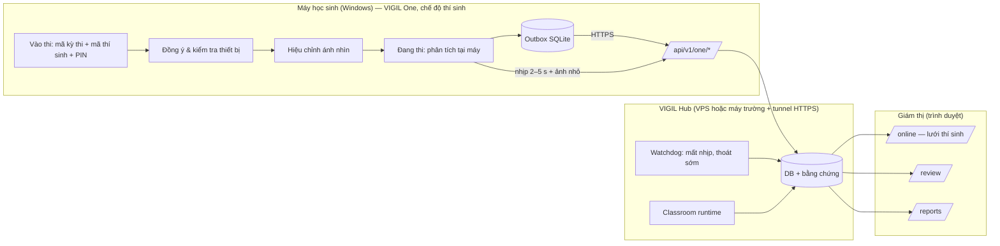

# VIGIL One cho thi online — nghiên cứu và thiết kế triển khai

| Mục | Giá trị |
|---|---|
| Ngày | 2026-10-14 |
| Nền | Nhánh `feat/vigil-one-hub`: One đã đồng bộ với VIGIL Hub (xem `SRS_HOAN_THIEN_DEMO_VIGIL_3_NGAY.md`, Phụ lục B) |
| Ý tưởng gốc | Phần mềm VIGIL One được **cài trên máy học sinh**, chạy trong giờ **thi online**, **gửi dữ liệu về máy chủ**; giám thị theo dõi trên **cùng dashboard** với VIGIL Classroom |

---

## 1. Kết luận ngắn

1. **Ý tưởng khả thi với nền hiện có.** Phần khó nhất (phân tích tại máy, gửi dữ liệu bền vững có outbox và retry, hàng đợi review chung, báo cáo chung) đã chạy và có test.
2. Để thành "phần mềm cài trên máy học sinh", cần thêm **năm khối**:

   | Khối | Mục đích |
   |---|---|
   | (A) Chế độ thí sinh | Giao diện tối giản, không có quyền chỉnh |
   | (B) Vào thi bằng mã kỳ thi + mã thí sinh | Thay cho ghép nối từng máy |
   | (C) Hub ra Internet qua HTTPS | Thí sinh ở nhà kết nối được |
   | (D) Tín hiệu toàn vẹn phía server | Mất kết nối, tắt app, camera ảo, nhiều màn hình |
   | (E) Màn hình giám sát lớp thi online | Theo dõi 30–100 thí sinh |

3. **Không cần viết lại perception.** App nhẹ: MediaPipe + OpenCV + Tkinter, model 8 MB, không PyTorch. Đóng gói PyInstaller dự kiến 150–250 MB, chạy được trên laptop phổ thông.
4. **Giới hạn phải nói rõ với người dùng:** máy thuộc quyền học sinh, nên phần mềm **không ngăn được** người cố tình gian lận. Nó làm bốn việc:
   - ghi nhận tín hiệu;
   - phát hiện các dấu hiệu né tránh (tắt app, mất kết nối, camera ảo);
   - đưa lên để giám thị rà soát;
   - không tự kết luận.

---

## 2. Hiện trạng so với ý tưởng

| Yêu cầu của ý tưởng | Đã có | Còn thiếu |
|---|---|---|
| Phân tích webcam tại máy học sinh | Có (mắt/iris, hướng đầu, số người, vật thể, giọng nói + môi, ánh sáng) | Cấu hình theo kỳ thi do server cấp (hiện chỉnh tay trên máy) |
| Gửi dữ liệu về máy chủ | Có: phiên, tín hiệu, ảnh SHA-256, đánh dấu, nhịp 2 s + ảnh live; outbox bền khi mất mạng | Xác thực theo thí sinh và kỳ thi; HTTPS |
| Cài trên máy học sinh | Không: chạy từ mã nguồn + venv | Bộ cài `.exe`, cập nhật phiên bản |
| Học sinh tự vận hành | Không: giao diện dành cho giám thị (ngưỡng, duyệt, xuất báo cáo, chọn video/mô phỏng) | Chế độ thí sinh: vào thi, đồng ý, kiểm tra thiết bị, hiệu chỉnh, đang thi, nộp |
| Theo dõi chung dashboard với Classroom | Có: `/review` lọc sản phẩm, `/reports`, `/wall` (tối đa 9 ô) | Màn hình lớp thi online nhiều thí sinh; cảnh báo mất kết nối |
| Thi qua Internet | Không: Hub chỉ localhost/LAN, token demo | Triển khai HTTPS công khai (tunnel hoặc VPS) |
| Chống né tránh | Chỉ có `CAMERA_INTERRUPTED` phía client | Tín hiệu do server sinh: mất nhịp, thoát sớm, camera ảo, đa màn hình, đồng hồ lệch |

---

## 3. Kiến trúc đích

Nguyên tắc giữ nguyên từ nhánh hiện tại:
- Phân tích tại máy, không stream video liên tục.
- Mọi thứ ghi cục bộ trước rồi mới gửi.
- Server khử trùng lặp.
- Quyết định thuộc về giám thị.

---

## 4. Thiết kế từng khối

### A. Chế độ thí sinh (client)

Một app, hai chế độ, chọn khi đóng gói (cờ trong file cấu hình đi kèm bộ cài):
- `mode = "candidate"`: bản phát cho học sinh.
- `mode = "proctor"`: giao diện hiện tại, cho phòng máy có người trực hoặc cho dev.

Luồng chế độ thí sinh (một cửa sổ, từng bước):

| Bước | Nội dung | Ghi chú |
|---|---|---|
| 1. Vào thi | Nhập mã kỳ thi (6–8 ký tự), mã thí sinh, PIN (từ danh sách thí sinh) | Hub trả về tên kỳ thi, giờ thi, chính sách giám sát |
| 2. Đồng ý | Hiện chính sách: dữ liệu thu thập, ai xem, lưu bao lâu; bắt buộc tick đồng ý | Lưu thời điểm đồng ý lên server |
| 3. Kiểm tra thiết bị | Camera mở được, thấy đúng 1 khuôn mặt, ánh sáng đủ, micro (nếu kỳ thi yêu cầu), mạng tới Hub | Không đạt thì hướng dẫn sửa; vẫn cho vào nếu giám thị cho phép |
| 4. Hiệu chỉnh | Nhìn vào tâm màn hình 3–5 giây (đã có) | — |
| 5. Đang thi | Cửa sổ nhỏ luôn nổi: "Đang được giám sát", trạng thái kết nối, camera thu nhỏ của chính mình | **Không** hiện cảnh báo chi tiết cho thí sinh (tránh "học cách né"), không có nút xem/sửa sự kiện, không chỉnh ngưỡng |
| 6. Kết thúc | Nút "Nộp bài / Kết thúc" hoặc server báo hết giờ; gửi nốt outbox, hiện "Đã gửi đủ dữ liệu" | Thoát trước giờ: hỏi xác nhận, server ghi tín hiệu `ONE_LEFT_EARLY` |

Chính sách giám sát do Hub cấp theo kỳ thi (tái dùng các ngưỡng hiện có):
- bật/tắt micro;
- cho phép tài liệu;
- ngưỡng từng tín hiệu;
- có gửi ảnh live không, chu kỳ gửi (2–5 s).

Thí sinh không chỉnh được các mục này.

### B. Vào thi theo mã (thay ghép nối từng máy)

Ghép nối bằng mã do giám thị cấp cho từng máy phù hợp phòng máy, nhưng không mở rộng được cho thi online. Đề xuất:

| Thành phần | Thiết kế |
|---|---|
| Danh sách thí sinh | Bảng mới `candidates` (exam_id, candidate_code, họ tên, PIN băm, trạng thái). Nhập CSV trên trang `/sessions` |
| Mã kỳ thi | `exams.join_code` (6–8 ký tự), bật/tắt, có thời gian hiệu lực (ví dụ mở trước giờ thi 30 phút) |
| API | `POST /api/v1/one/client/join {join_code, candidate_code, pin, device_info}` → token **gắn với phiên của thí sinh đó** (không phải token thiết bị dùng mãi); hết hạn sau giờ thi + 2 giờ |
| Chống vào hộ / vào trùng | Một thí sinh chỉ có một phiên đang chạy; vào lại từ máy khác thì giám thị thấy cảnh báo "đổi thiết bị" và phải cho phép |
| Tương thích | Ghép nối thiết bị hiện có giữ nguyên cho phòng máy / demo |

Phần còn lại của API (`events`, `evidence`, `bookmarks`, `heartbeat`, `stop`) dùng lại nguyên vẹn, chỉ đổi cách lấy token.

### C. Đưa Hub ra Internet

| Phương án | Ưu | Nhược | Dùng khi |
|---|---|---|---|
| **Cloudflare Tunnel** (hoặc ngrok) từ máy trường/laptop | 15 phút là có HTTPS công khai, không mở cổng router | Phụ thuộc máy chủ đang bật; băng thông nhà mạng | Demo, thử nghiệm nhỏ (≤ 30 thí sinh) |
| **VPS + Caddy** (HTTPS tự động) | Ổn định, IP cố định, kiểm soát hoàn toàn | Chi phí thuê VPS; cần chuyển DB và bằng chứng lên VPS | Pilot thật |
| Dịch vụ của trường | Đúng quy định dữ liệu | Thủ tục | Triển khai chính thức |

Yêu cầu chung:
- Bắt buộc HTTPS cho `/api/v1/one/client/*`; client từ chối `http://` trừ địa chỉ `localhost`.
- `VIGIL_AUTH_MODE=required` cho web.
- Giới hạn tốc độ theo token.
- Giới hạn kích thước ảnh (đã có: 5 MB, chỉ JPEG).

Ước lượng băng thông về Hub:

| Nguồn dữ liệu | Mỗi thí sinh | 100 thí sinh |
|---|---|---|
| Ảnh live 640 px, q70, ~35 KB mỗi 2 s | ~17 KB/s | ~1,7 MB/s ≈ 14 Mbit/s |
| Ảnh live 320 px mỗi 5 s | ~2 KB/s | ~0,2 MB/s |

Ảnh bằng chứng chỉ gửi khi có tín hiệu, không đáng kể. Đề xuất mặc định: 320 px mỗi 5 s; giám thị bấm vào thí sinh thì Hub yêu cầu client tăng lên 640 px mỗi 2 s trong 60 giây.

### D. Tín hiệu toàn vẹn

Máy học sinh không đáng tin tuyệt đối, nên các tín hiệu dưới đây do **server** sinh hoặc xác nhận, và đều là tín hiệu để rà soát.

| Tín hiệu | Cách phát hiện | Phía |
|---|---|---|
| `ONE_CLIENT_OFFLINE` | Quá 30 s không có nhịp trong giờ thi; đóng lại khi nhịp quay lại, ghi tổng thời gian mất | Server (watchdog) |
| `ONE_LEFT_EARLY` | Phiên kết thúc trước giờ thi mà giám thị chưa cho phép | Server |
| `ONE_VIRTUAL_CAMERA` | Tên thiết bị camera chứa OBS / ManyCam / Snap Camera / "Virtual"… | Client báo, server lưu |
| `ONE_MULTIPLE_DISPLAYS` | Số màn hình > 1 lúc vào thi và trong lúc thi | Client |
| `ONE_DEVICE_CHANGED` | Vào lại từ máy khác (khác `device_info`) | Server |
| `ONE_CLOCK_SKEW` | Đồng hồ máy lệch > 2 phút so với server | Server |
| Các tín hiệu hiện có | Nhìn ra ngoài, quay đầu, không thấy mặt, nhiều người, vật thể, nói chuyện, ánh sáng | Client |

**Không làm** (ngoài phạm vi, rủi ro riêng tư hoặc pháp lý):
- khóa máy hay chặn ứng dụng khác (lockdown browser);
- ghi màn hình liên tục;
- nhận diện khuôn mặt.

Có thể kết hợp với phần mềm thi hiện có của trường (ví dụ Safe Exam Browser) nếu đơn vị cần khóa máy.

### E. Màn hình giám sát lớp thi online (web)

Trang mới `/online?exam=<id>` trong cùng dashboard với Classroom (menu MONITOR):
- **Lưới thí sinh** (ảnh live nhỏ, mã thí sinh, chấm trạng thái: đang thi / mất kết nối / chưa vào / đã nộp, số tín hiệu chờ). Sắp xếp mặc định: mất kết nối và nhiều tín hiệu lên đầu; phân trang 24/48/96.
- **Thanh tổng:** đã vào / đang thi / mất kết nối / đã nộp / chưa vào (so với danh sách thí sinh).
- **Bấm vào thí sinh:** ảnh live lớn (tăng tần suất tạm thời), dòng thời gian tín hiệu của phiên, nút mở `/review` lọc sẵn phiên đó, ghi chú của giám thị, "cho phép vào lại / đổi thiết bị / thoát sớm".
- Cập nhật qua WebSocket sẵn có (`ONE_HEARTBEAT`, `ONE_EVENTS`…), không cần tải lại trang.
- `/review`, `/reports`, `/playback` dùng chung như hiện nay.

### F. Đóng gói và phát hành

| Hạng mục | Thiết kế |
|---|---|
| Đóng gói | PyInstaller `--onedir` (khởi động nhanh hơn `--onefile`); thu kèm data của MediaPipe (`--collect-data mediapipe`) và hai model trong `exam_monitor/assets` |
| Bộ cài | Inno Setup: cài vào `%LOCALAPPDATA%\VIGIL One` (không cần quyền admin), tạo shortcut, gỡ cài đặt sạch |
| Cấu hình đi kèm | `vigil-one.json`: địa chỉ Hub, `mode=candidate`. Mỗi trường có thể build một bộ cài riêng |
| Dữ liệu trên máy | Chuyển `DATA_DIR` từ thư mục mã nguồn sang `%LOCALAPPDATA%\VIGIL One\data`; xóa dữ liệu cục bộ sau khi Hub xác nhận đã nhận đủ, tùy chính sách |
| Cập nhật | Hub công bố `GET /api/v1/one/client/version`; client cũ hơn mức tối thiểu thì báo tải bản mới |
| Ký số | Chưa có chứng thư số thì Windows SmartScreen sẽ cảnh báo; ghi vào hướng dẫn cài đặt, cân nhắc mua chứng thư khi pilot |
| Hệ điều hành | Windows 10/11 trước. macOS sau, vì quyền camera và notarization tốn thời gian |

### G. Riêng tư và pháp lý (cần đơn vị tổ chức thi quyết định)

- Màn hình đồng ý bắt buộc. Thông báo rõ: dữ liệu gì (tín hiệu, ảnh lúc có tín hiệu, ảnh live nhỏ không lưu), ai xem, lưu bao lâu, cách khiếu nại.
- Thời hạn lưu: ảnh bằng chứng của tín hiệu bị bác bỏ xóa sau N ngày; tín hiệu đã xác nhận lưu theo quy chế thi.
- Không nhận diện khuôn mặt. Định danh thí sinh bằng mã + PIN do đơn vị cấp.
- Tuân thủ quy định bảo vệ dữ liệu cá nhân của Việt Nam (Nghị định 13/2023/NĐ-CP): có căn cứ xử lý, có thông báo và có sự đồng ý của chủ thể dữ liệu. Với học sinh chưa thành niên, cần lưu ý thêm sự đồng ý của cha mẹ hoặc người giám hộ.

---

## 5. Lộ trình triển khai đề xuất

| Giai đoạn | Nội dung | Kết quả nhìn thấy | Ước lượng |
|---|---|---|---|
| **GĐ1 — Thí sinh tự vào thi** | Bảng thí sinh + mã kỳ thi; API `join`; chế độ thí sinh (vào thi, đồng ý, kiểm tra thiết bị, đang thi, nộp); chính sách theo kỳ thi | Học sinh mở app, nhập mã, thi; giám thị thấy trên `/review` | 3–4 ngày |
| **GĐ2 — Giám sát lớp online** | Trang `/online`; watchdog `ONE_CLIENT_OFFLINE` / `ONE_LEFT_EARLY`; điều chỉnh tần suất ảnh live | Giám thị theo dõi cả lớp, thấy ai mất kết nối | 2–3 ngày |
| **GĐ3 — Đóng gói và Internet** | PyInstaller + Inno Setup; `DATA_DIR` theo người dùng; Cloudflare Tunnel cho demo; HTTPS bắt buộc | File `VIGIL-One-Setup.exe` cài trên máy bất kỳ, kết nối Hub qua Internet | 2–3 ngày |
| **GĐ4 — Toàn vẹn và pilot** | Camera ảo, đa màn hình, đổi thiết bị, lệch giờ; kiểm thử tải 50–100 client mô phỏng (`scripts/one_fake_client.py`); hướng dẫn cài cho học sinh | Báo cáo tải, checklist pilot | 2–3 ngày |

Thử thách kỹ thuật lớn nhất cần làm sớm (spike ở đầu GĐ3, có thể kéo lên GĐ1): **đóng gói MediaPipe bằng PyInstaller** (hay thiếu file data hoặc DLL) và kiểm tra trên một máy Windows sạch không cài Python.

---

## 6. Rủi ro

| Rủi ro | Mức | Giảm thiểu |
|---|---|---|
| Đóng gói MediaPipe lỗi trên máy sạch | Cao | Spike sớm; giữ `--onedir`; kiểm trên máy ảo Windows sạch |
| Học sinh né bằng camera ảo hoặc máy thứ hai | Cao | Tín hiệu `ONE_VIRTUAL_CAMERA`, người lạ trong khung, ảnh live; nói rõ đây là hỗ trợ, không phải chống gian lận tuyệt đối |
| Mạng nhà học sinh yếu | Trung bình | Outbox đã có; ảnh live thưa (5 s, 320 px); tín hiệu mất kết nối do server đánh giá có ngưỡng |
| Máy học sinh yếu (CPU) | Trung bình | Giới hạn FPS phân tích 10–15; tắt phát hiện vật thể theo chính sách; đo trên laptop phổ thông |
| SmartScreen chặn bộ cài | Trung bình | Hướng dẫn cài; chứng thư ký số khi pilot |
| Quyền riêng tư và đồng ý của trẻ vị thành niên | Cao (pháp lý) | Màn hình đồng ý, chính sách lưu trữ, quyết định của đơn vị tổ chức |
| Băng thông Hub khi đông | Trung bình | Ảnh live thích ứng; đo tải ở GĐ4 |

---

## 7. Quyết định cần chủ dự án

1. **Cách thí sinh vào thi:** mã kỳ thi + mã thí sinh + PIN theo danh sách nhập trước (đề xuất), hay chỉ mã kỳ thi + tự khai mã thí sinh (nhanh cho demo, dễ vào hộ)?
2. **Hạ tầng Internet cho giai đoạn đầu:** Cloudflare Tunnel từ máy có sẵn (đề xuất cho demo), hay thuê VPS ngay?
3. **Thí sinh có thấy cảnh báo của chính mình không?** Đề xuất: không hiện chi tiết, chỉ hiện "đang được giám sát" và trạng thái kết nối.
4. **Ảnh live:** có gửi không, và tần suất mặc định (đề xuất 320 px mỗi 5 s, tăng khi giám thị mở xem)?
5. **Thứ tự ưu tiên:** làm GĐ1 + GĐ2 trước để demo trên một máy (khuyến nghị), hay làm GĐ3 đóng gói ngay?

---

## 8. Trạng thái triển khai (2026-10-14, nhánh `feat/vigil-one-hub`)

Quyết định §7 đã được chấp nhận theo đề xuất: mã kỳ thi + mã thí sinh + PIN; Cloudflare Tunnel cho demo; thí sinh không thấy cảnh báo chi tiết; ảnh live 320 px mỗi 5 s, tăng lên 640 px mỗi 2 s khi giám thị mở xem; làm GĐ1 + GĐ2 trước.

| Hạng mục | Trạng thái | Nơi thực hiện |
|---|---|---|
| Danh sách thí sinh, mã vào thi, chính sách theo kỳ thi | Xong | bảng `candidates`; `exams.join_code/join_open/one_policy_json`; `storage/online_exam_service.py` |
| API vào thi, đồng ý, chính sách; token gắn thí sinh, hết hạn sau 12 giờ | Xong | `api/routes/one.py` (`/client/join`, `/client/consent`, `/client/policy`) |
| Chế độ thí sinh (vào thi → đồng ý → kiểm tra thiết bị → làm bài → nộp) | Xong | `exam_monitor/candidate_app.py`; `python main.py --candidate` hoặc `vigil-one.json` có `"mode": "candidate"` |
| Tín hiệu toàn vẹn | Xong | `ONE_CLIENT_OFFLINE` (watchdog 10 s), `ONE_LEFT_EARLY`, `ONE_DEVICE_CHANGED`, `ONE_CLOCK_SKEW` (server); `ONE_VIRTUAL_CAMERA`, `ONE_MULTIPLE_DISPLAYS` (client báo) |
| Ảnh live thích ứng + tăng khi giám thị xem | Xong | phản hồi heartbeat `live`; `POST /one/sessions/{id}/boost` |
| HTTPS bắt buộc khi Hub ở Internet | Xong (phía client) | `check_transport`: http chỉ cho localhost/LAN nội bộ |
| Trang `/online` (lưới thí sinh, KPI, thiết lập kỳ thi, nhập danh sách, PIN, chi tiết thí sinh) | Xong | `dashboard/online.html`, `js/online.js`, `css/online.css` |
| Logo V và font DMC5 | Xong | web: tất cả trang; One: hai chế độ (font nạp riêng cho tiến trình) |
| GĐ3 đóng gói | Xong (bản zip di động) | `packaging/` (spec PyInstaller, hook `webrtcvad-wheels`, script Inno Setup, `build_vigil_one.py`); `exam_monitor/paths.py` (dữ liệu ở `%LOCALAPPDATA%\VIGIL One`); `--selftest`. Bộ cài `.exe` cần Inno Setup (chưa được phép tải) |
| GĐ3 Hub ra Internet (Cloudflare Tunnel) | Chưa | chưa được phép tải `cloudflared` |
| GĐ4 kiểm thử tải | Xong (40 client) | `scripts/one_load_test.py` |
| GĐ4 hướng dẫn cho học sinh | Xong | `docs/HUONG_DAN_HOC_SINH_VIGIL_ONE.md` |

**Đóng gói (2026-10-14):**
- `dist/VIGIL-One-2.0.0-win64.zip`: 162 MB nén, 351 MB sau giải nén (OpenCV 138 MB, MediaPipe 92 MB).
- Chạy trên môi trường sạch (PATH không có Python/venv, `LOCALAPPDATA` riêng): `--selftest` báo MediaPipe Face Landmarker + EfficientDet nạp được, phân tích 41 ms/khung, camera mở được, logo và font hiển thị.
- Hai lỗi đóng gói đã sửa:
  - MediaPipe cần `matplotlib` khi import;
  - thiếu Haar cascade cho chế độ dự phòng.

**Kiểm thử tải (40 thí sinh mô phỏng, 120 s, cùng máy với Hub):**

| Chỉ số | Kết quả |
|---|---|
| Tín hiệu nhận | 200/200, đều có ảnh bằng chứng |
| Cảnh báo mất kết nối nhầm | 0 |
| Roster `/online` (70 thí sinh) | trung vị 62 ms, tối đa 104 ms |
| CPU Hub | trung vị 1,7 %, tối đa 4,9 % |
| RAM Hub | ~550 MB (gồm model Classroom nạp sẵn) |

Chưa đo qua mạng Internet thật và chưa đo tới 100 client.

Kiểm chứng:
- 400/400 test pass, trong đó `tests/test_online_exam.py` có 10 test cho luồng thi online.
- App thí sinh chạy thật qua cả 5 bước (camera mô phỏng); Hub nhận đủ tín hiệu và ảnh, roster `SUBMITTED`.
- 3 thí sinh mô phỏng vào thi đồng thời hiện trên `/online`. Tắt ngang một máy: sau ~40 s máy đó chuyển `LOST` và có tín hiệu `ONE_CLIENT_OFFLINE`.

Lưu ý giấy phép: font DMC5 ("Dmc5 Font By Kalina Ann") chỉ miễn phí cho dự án cá nhân; cần hỏi tác giả trước khi dùng công khai hoặc thương mại (`dashboard/assets/fonts/README.md`).
